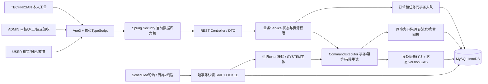

# LeaseGuard架构

LeaseGuard解决型号库存租赁中的履约与责任交接：用户提交归还不立即释放库存，技师提交维修不立即恢复设备，超时任务不能重复释放库存。上游提供基础业务骨架，个人增量聚焦这些边界和可验证工程行为。

模块化单体，Java21/Boot3.5.16/MyBatis-Plus/MySQL8.4/Flyway。没有Redis、MQ、微服务、AI或真实支付。`drone`是型号级库存，不是逐台序列号资产；每单占用一个单位。

认证每请求查数据库当前role/status/credentialStamp；SYSTEM禁用且不能登录。USER0只读本人订单/故障，TECH2查询SQL限制assignee_id，ADMIN1派工/验收。权限检查既在HTTP层，也在Service及幂等回放之前；不能凭旧JWT角色获得权限。

命令使用唯一(actor,operation,key)及参数摘要，回执在业务事务中提交；网络未知结果复用同Key，禁止换Key强制重复业务。锁按设备→订单→故障→工单→归还顺序，状态和version共同CAS。派工要求PENDING及期望版本，目标必须是启用真实技师；开始后禁止转派。

超时任务认领、业务命令、任务回写是有意分离的短事务；Worker复用原取消/库存协议。业务已提交而回写失败时重放同一系统命令恢复；过期worker不能越过租约token完成。任务页面只读，没有直接改FAILED为PENDING的入口。

列表分页后批量窄投影或带范围JOIN，保持稳定created_time/id排序和size≤100。V6仅增加测量支持的索引，V1—V5不改。没有通过缓存授权/库存、移除COUNT/权限/事务换取性能。

性能测量器只在test-classpath显式启动，包含JDBC/装配/连接池快照；发布生产JAR不含测量器和测试端点。上传/下载因尚无文件所有权模型默认关闭，候选只使用自制SVG和合成页面截图。

参见[状态机](STATE_MACHINES.md)、[ER图](ER.md)、[角色/API](API.md)、[G5性能](G5_PERFORMANCE.md)、[安全审查](G5_SECURITY_REVIEW.md)。
