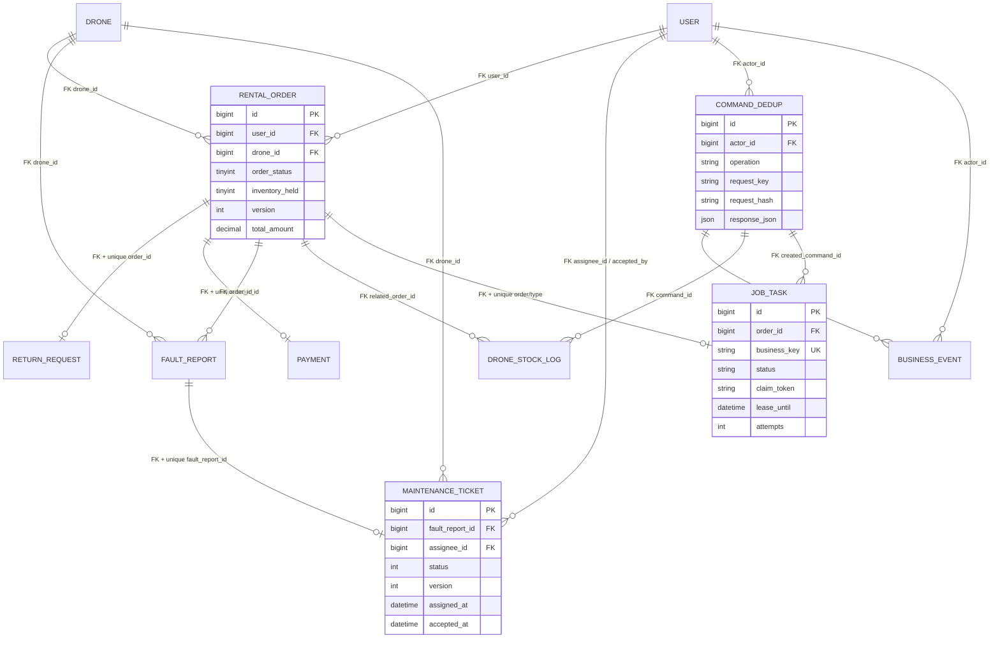

# 主要表与约束

图中FK均对应正式迁移；未列出的旧字段/表不意味着已补全所有外键。资质、空域、评论、信用记录等上游表保留，不把逻辑关联宣传成数据库外键。

- `command_dedup`唯一(actor_id,operation,request_key)，请求参数不同不能复用Key。
- 库存流水唯一(related_order_id,inventory_effect)，确保每单分配/释放各至多一次；无关联单的管理调整不冒充订单释放。
- `business_event`唯一(command_id,seq_no)，事件与命令/库存同事务。
- CHECK限制非负库存、held∈{0,1}、合法状态/角色及不可登录SYSTEM。
- V6 owner/state/global-time/assignee-time组合索引支持实测分页/COUNT；COUNT与深OFFSET仍有扫描成本，不声称复杂查询已全部最优。
