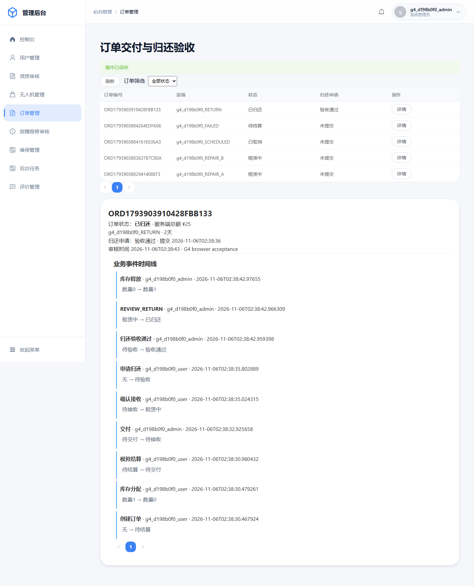
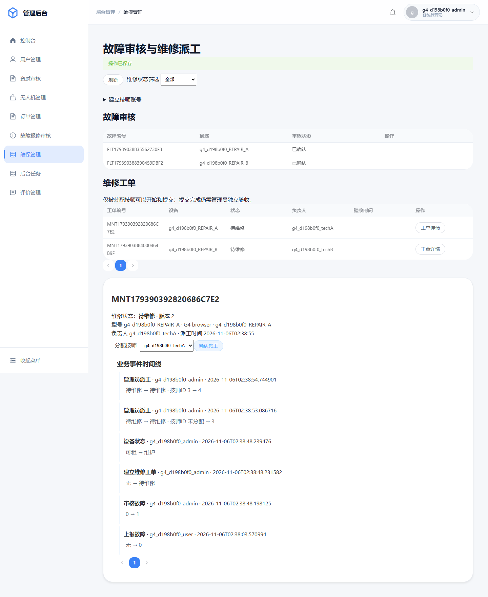
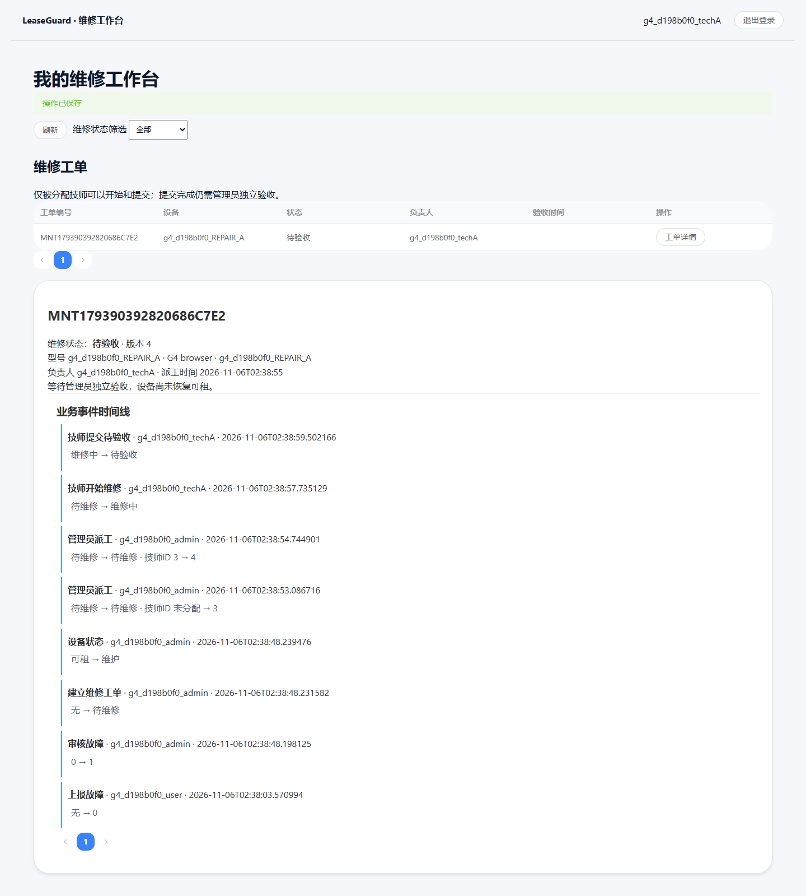
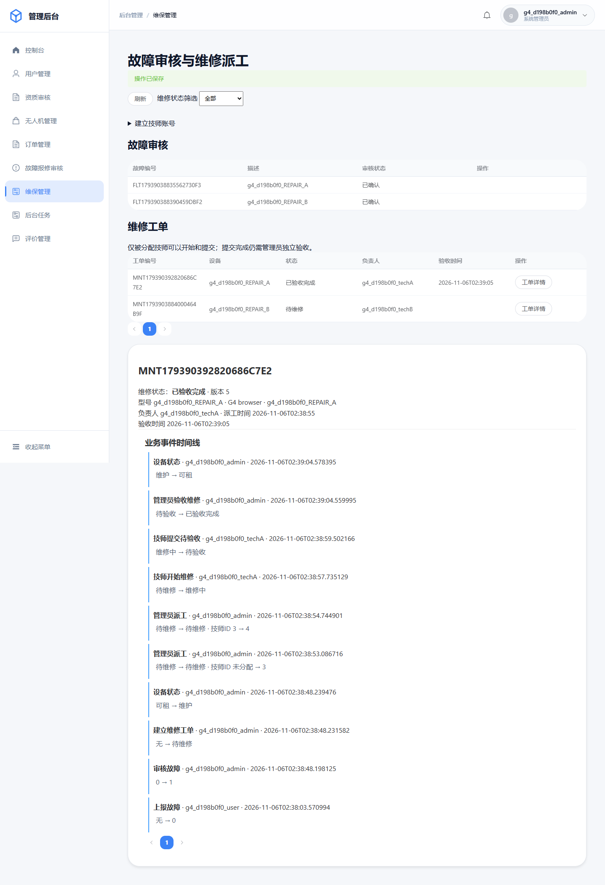
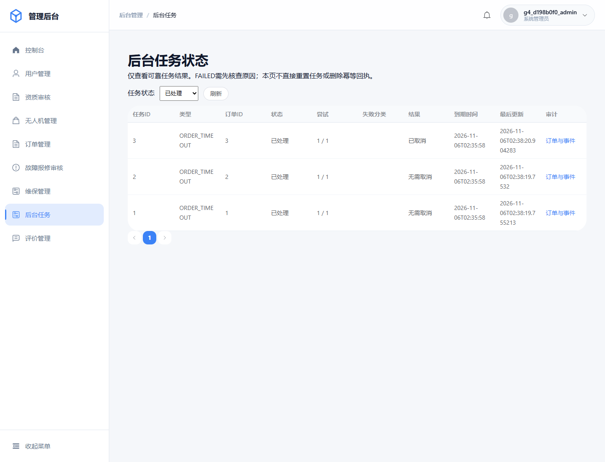
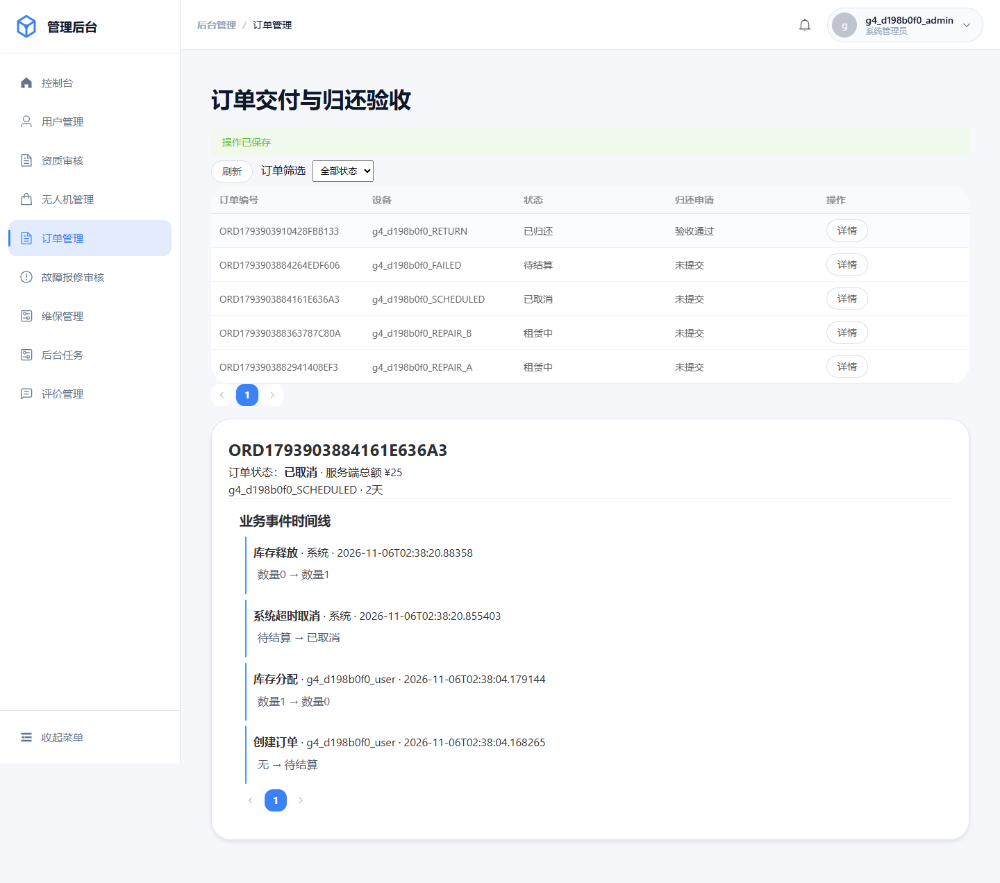

# G5公开源码候选验收

**本地源码展示候选独立复现通过；未推送GitHub，未运行远程Actions，不构成生产部署批准。** 验证源码提交：`a26037074d1a0a49968547233a5151ce30f414d2`。之后封存提交只整理报告、脱敏证据与打包审计，不改变已验证应用输入；打包器逐文件比对验证副本。

## 独立验证事实

候选通过白名单生成，无原开发.git、私有.env/DPAPI、datadir、依赖缓存、node_modules、target/dist、原始Trace、来源不明图片或重复施工日志。公开目录与验证目录分离，验证在新建数据目录、MySQL UUID `d567f5f2-d946-11f1-807f-005056c00001` 上执行，原实例停止且原数据保留。新实例最初LeaseGuard catalog数量0，端口13308，仅127.0.0.1。

同一套可公开移植脚本 `scripts/portable/verify.py` 使用操作者临时环境变量与随机分离账号，不导入作者DPAPI辅助模块；外围本地实例管理才使用私有凭据。复用了已安装Java/Maven/Chrome与依赖下载缓存，不是离线/无缓存安装证明。npm ci在候选无node_modules目录实际执行。

|项目|实际结果|
|---|---|
|Java编译/打包与全量测试|92项：22单元、70真实MySQL，失败/错误/跳过均0|
|Flyway|新catalog正式迁移V1—V6；包括空库、增量及迁移约束测试|
|并发与恢复|完整G2 270轮×20任务、G3抢占/双JVM恢复、G4派工与权限测试再次执行|
|前端|npm ci、5项操作键/交互单元、typecheck、生产build全部通过|
|真实浏览器|Playwright-core1.64.1 + 已安装Chrome156.0.8078.80；4独立Context、26断言、13新截图|
|目标确认|固定导航127.0.0.1:15174，API127.0.0.1:18084，origin allowlist；意外外部请求0、页面异常0、非预期HTTP500为0|
|业务链|新订单创建/模拟支付/交付/归还/审核；故障审核/派工/技师开始与提交/管理员验收；真实定时超时取消与审计|
|额外交互|重复点击受控、已提交响应丢失同键恢复、真实过期派工409刷新、其他技师工单404|
|数据库Gold|每个中间状态及最终真实MySQL只读快照通过；单次释放、提交不等于验收、SYSTEM任务归属均核对|
|API|运行中实际导出OpenAPI；关闭上传接口不再列入，文件入口各角色拒绝测试通过|

证据：[独立结果](evidence/g5/candidate-verification.json)、[浏览器断言](evidence/reproduce/browser/browser-result.json)、[最终数据库事实](evidence/reproduce/browser/db-final.json)、[运行中OpenAPI](evidence/reproduce/openapi.json)。原始Trace仅私有保留，不入公开包。

## 保留的失败与修复

第一次新实例初始化使用UTF-8 ini，在本机中文路径被Windows MySQL按本地编码解释失败；保留日志，新数据目录改为匹配原工具的MBCS配置后正常，不修改权限或全局设置。第一次独立完整验证已通过92项Java及前端构建，但Vite dev首次预打包触发HMR，登录后页面重载导致浏览器链超时。失败目录完整保留，未放宽断言或加长sleep；改用刚构建的vite preview并明确127.0.0.1代理，再次从另一全新datadir执行全量流程通过。不是把开发工作区旧截图搬成独立成功证据。

## 代表性页面

全部来自本轮独立实例的合成账号，不含Token、证件或客户数据。

## 包装与可验证范围

独立候选ZIP与旁置文件Manifest由同一脚本生成。MANIFEST.sha256逐文件覆盖公开包全部文件，排除自身；ZIP整体散列另见旁置SHA256SUMS.txt，避免自引用。打包检查源码与已验证副本一致、秘密模式/已知真实凭据无匹配、Markdown本地目标存在，并再从ZIP解压读取逐一校验Manifest。保留LICENSE/NOTICE、明确上游固定源码与个人增量；不携带作者开发Git历史，后续发布须另行授权。

当前独立环境实测为Windows，本轮未在Linux或远程GitHub Actions执行。存在深OFFSET和contains扫描瓶颈、大前端chunk、非核心旧JS页面。Boot支持周期、2项Spring MVC条件性公告、localStorage/TLS/限流/生产密钥治理和附件所有权模型等见[安全审查](G5_SECURITY_REVIEW.md)；不得将源码候选通过写成生产安全就绪。

## G5-AI建议

先以已验证Java核心投递和展示。AI不是补齐Java竞争力的必要条件；若后续仍需差异化，再独立授权G5-AI，保持V2的LangChain4j1.23.0、中文关键词检索、合成SOP、授权只读快照和默认关闭，不引入向量库或任意SQL/业务写入。本轮未实现、未下载AI模块依赖、未调用模型。
