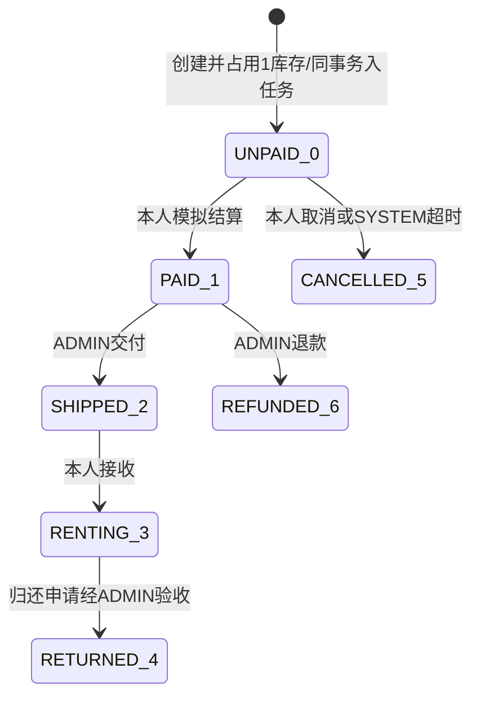
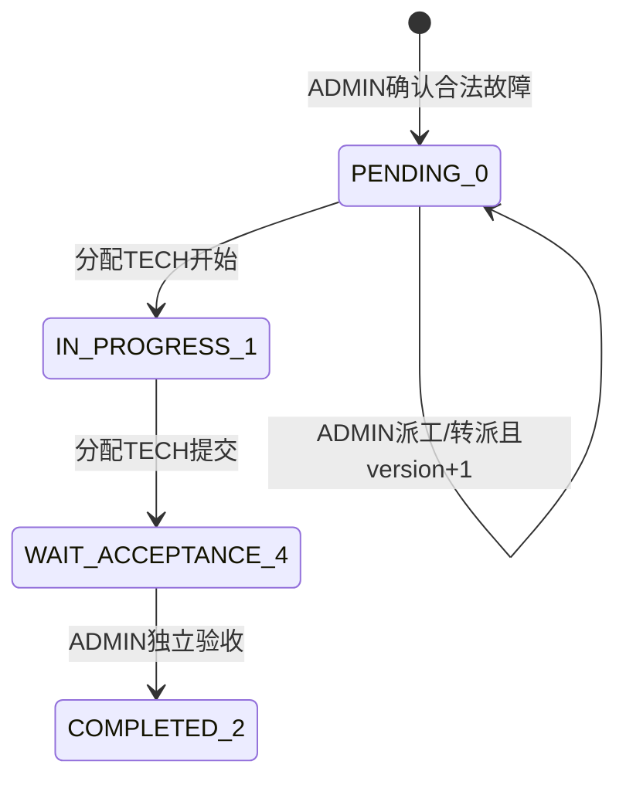
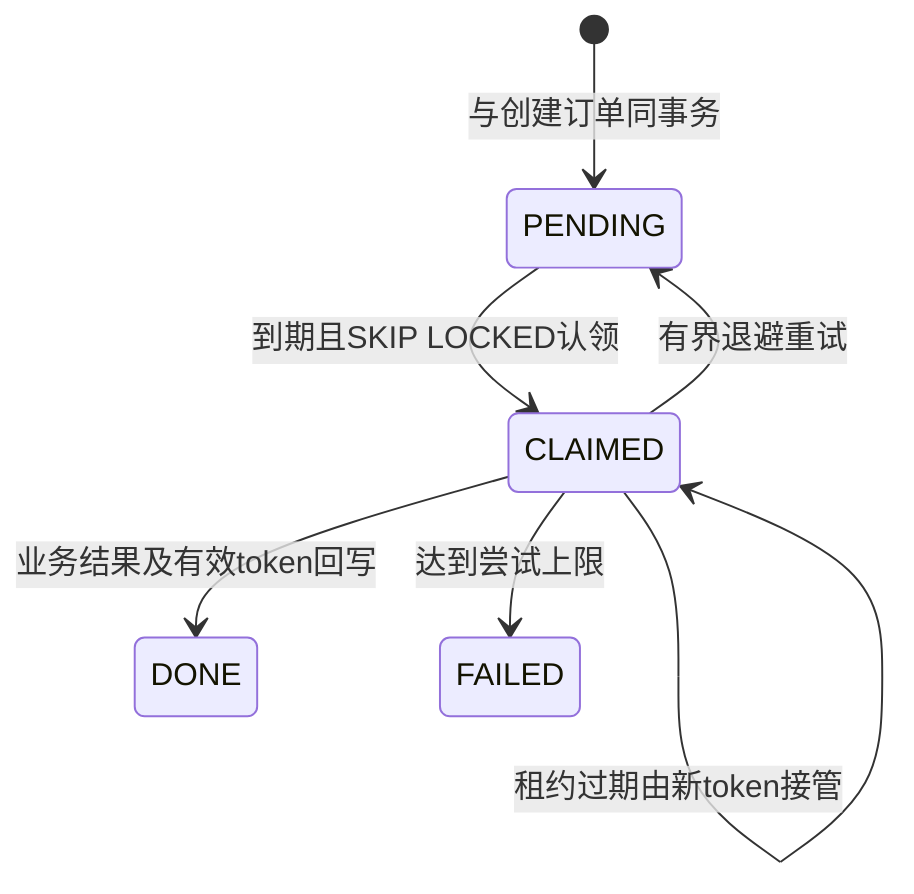

# 核心状态与不变量

归还申请0待审核、1通过、2驳回。申请/驳回不释放库存；通过同事务写申请、订单、一次RELEASE与事件。`inventory_held`由1变0，不能依靠重复调用stock+1实现“幂等”。

维修CANCELLED=3原码不变。提交完成保持维护状态；验收需检查其他活动工单、库存与上架状态，不能无条件恢复可租。维修状态转换不分配/释放库存。assigneeName是显示字段，只有真实assignee_id授权。

只有新订单入任务，既有历史订单不自动补建。UNPAID且仍持有库存才可超时取消；其他状态是NO_ACTION。SYSTEM不能登录，超时没有公开HTTP入口。真实进程崩溃、提交后回写失败、旧worker被栅栏拒绝均有MySQL测试，不依赖Mock数据库。
